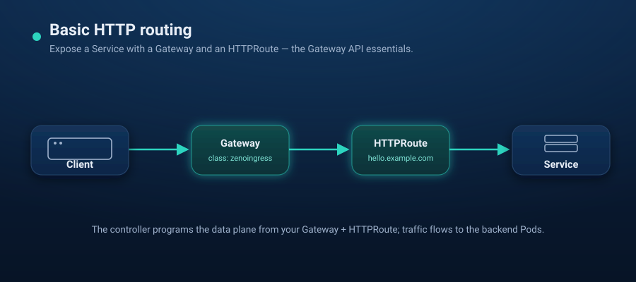

# Scenario 01 — Basic HTTP routing



Expose a simple HTTP service through zenoingress using the Gateway API.

## Prerequisites

- zenoingress installed (see the [root README](../../README.md#quick-start))
- Gateway API v1.6.1 CRDs installed (`kubectl apply --server-side -f https://github.com/kubernetes-sigs/gateway-api/releases/download/v1.6.1/standard-install.yaml`)
- `kubectl` access to the cluster

## Steps

1. Deploy a sample app:

   ```bash
   kubectl create deployment hello --image=nginxdemos/hello --port=80
   kubectl expose deployment hello --port=80
   ```

2. Create a `Gateway` served by the `zenoingress` GatewayClass:

   ```yaml
   # gateway.yaml
   apiVersion: gateway.networking.k8s.io/v1
   kind: Gateway
   metadata:
     name: web
     namespace: default
   spec:
     gatewayClassName: zenoingress
     listeners:
       - name: http
         port: 80
         protocol: HTTP
   ```

3. Route traffic to the service with an `HTTPRoute`:

   ```yaml
   # httproute.yaml
   apiVersion: gateway.networking.k8s.io/v1
   kind: HTTPRoute
   metadata:
     name: hello
     namespace: default
   spec:
     parentRefs:
       - name: web
     hostnames:
       - "hello.example.com"
     rules:
       - matches:
           - path:
               type: PathPrefix
               value: /
         backendRefs:
           - name: hello
             port: 80
   ```

   ```bash
   kubectl apply -f gateway.yaml -f httproute.yaml
   ```

4. Verify and test. ZenoIngress starts a proxy for this Gateway (a Deployment
   and a Service named `web-zenoingress`, in the Gateway's namespace) and
   reports the Service's address on the Gateway. `PROGRAMMED` turns `True` once
   that proxy runs and has an address:

   ```bash
   kubectl wait --for=condition=Programmed gateway/web --timeout=180s
   kubectl get gateway web          # ADDRESS = the proxy Service's load-balancer IP
   GATEWAY_IP=$(kubectl get gateway web -o jsonpath='{.status.addresses[0].value}')
   curl -H "Host: hello.example.com" "http://$GATEWAY_IP/"
   ```

   No load balancer in your cluster (kind, bare metal without MetalLB)? The
   Service then never gets an external IP and the Gateway waits in
   `AddressNotAssigned`. Install with `--set proxy.service.type=ClusterIP` (or
   `NodePort`) and reach it with
   `kubectl port-forward svc/web-zenoingress 8080:80`.

## Cleanup

```bash
kubectl delete httproute hello
kubectl delete gateway web        # also removes the Gateway's proxy
kubectl delete service hello
kubectl delete deployment hello
```
