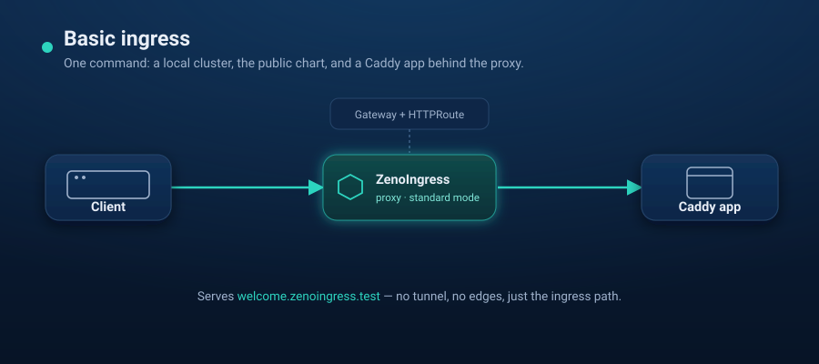

# Scenario 02 — Basic ingress



The smallest ZenoIngress demo: a static page served by Caddy, exposed through the
**standard** ingress path (Gateway API, no tunnel, no edges).

```
curl -> ZenoIngress proxy -> HTTPRoute -> Gateway (class: zenoingress) -> Caddy
```

Unlike [scenario 01](../01-basic-http-routing/) — which assumes zenoingress is
already installed and walks the manifests by hand — this one is **self-contained**:
`up.sh` creates a local `kind` cluster and installs zenoingress from the public
chart for you.

## Prerequisites

- `docker`, [`kind`](https://kind.sigs.k8s.io/), `kubectl`, and [`helm`](https://helm.sh/) 3.8+ (OCI support)
- Internet access from the cluster (to pull the public images and Gateway API CRDs)

## Run

```bash
./up.sh        # kind cluster + Gateway API CRDs + ZenoIngress + Caddy app
./verify.sh    # port-forwards the proxy and curls welcome.zenoingress.test
./down.sh      # delete the kind cluster
```

## What's in it

- **`k8s/manifests.yaml`** — everything in one namespace (`simple-ingress`): a
  ConfigMap holding `index.html`, a Caddy Deployment that mounts it at
  `/usr/share/caddy`, a Service, a `Gateway` on the `zenoingress` class, and an
  `HTTPRoute` for `welcome.zenoingress.test`. No custom image — the official
  `caddy:2-alpine` serves whatever is mounted at its web root.
- **`up.sh`** — installs the chart with `proxy.service.type=ClusterIP` and one
  proxy replica (kind has no load balancer). The controller then starts a proxy
  for the Gateway: a Deployment and a Service named `simple-gateway-zenoingress`
  in `simple-ingress`, owned by the Gateway. `verify.sh` reaches that Service
  with `kubectl port-forward`, and also checks that a host without a route gets
  404.
