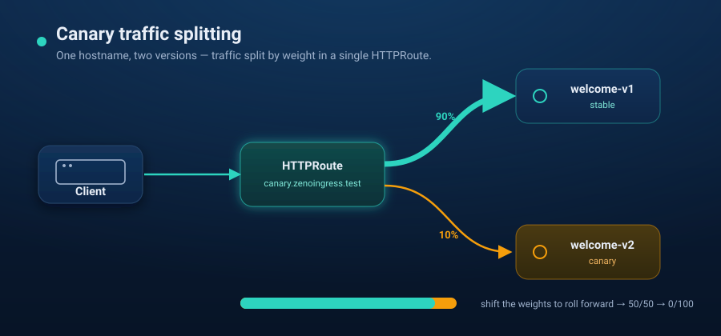

# Scenario 03 — Canary traffic splitting



A progressive-delivery demo: one hostname, two versions, traffic split by weight
through a single `HTTPRoute`. This is native Gateway API weighting — no license,
no special load-balancer config.

```
curl canary.zenoingress.test
        │
   HTTPRoute (weighted backendRefs)
        ├── 90 → welcome-v1  (stable)
        └── 10 → welcome-v2  (canary)
```

`up.sh` is self-contained: it creates a local `kind` cluster and installs
zenoingress from the public chart.

## Prerequisites

- `docker`, [`kind`](https://kind.sigs.k8s.io/), `kubectl`, and [`helm`](https://helm.sh/) 3.8+ (OCI support)
- Internet access from the cluster (public images + Gateway API CRDs)

## Run

```bash
./up.sh          # kind + ZenoIngress (standard mode) + v1/v2 apps + weighted route
./verify.sh      # fires 40 requests, prints the v1/v2 split
./verify.sh 200  # more requests → split converges toward 90/10
./down.sh        # delete the kind cluster
```

## Shifting the canary

Edit the two `weight:` values in `k8s/manifests.yaml` and re-apply
(`kubectl apply -f k8s/manifests.yaml`) — e.g. `50/50`, then `0/100` to complete
the rollout. Only the `HTTPRoute` changes; nothing restarts.

> Backends here are two Caddy pods serving a `v1`/`v2` page so the split is
> visible. The same weighting works at **gRPC method** granularity via
> `GRPCRoute` — a gRPC variant of this scenario could be added later.
