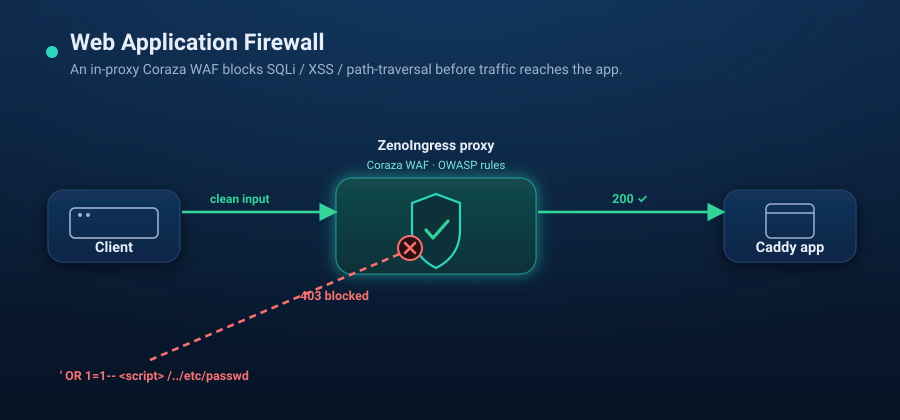

# Scenario 04 — Web Application Firewall (WAF)



A regulated-app demo: a small JS form page behind ZenoIngress with an **in-proxy
Coraza WAF** on the route (SQLi/XSS/traversal detection). Clean input reaches the
app; attack payloads are blocked in the proxy before they ever touch the backend.

```
curl / browser -> ZenoIngress proxy [Coraza WAF] -> Caddy (form page)
                        │
                   403 on SQLi / XSS / path-traversal
                   200 on clean input
```

`up.sh` is self-contained: it creates a local `kind` cluster and installs
zenoingress from the public chart.

## Prerequisites

- `docker`, [`kind`](https://kind.sigs.k8s.io/), `kubectl`, and [`helm`](https://helm.sh/) 3.8+ (OCI support)
- **Internet from the cluster** — the proxy's init container downloads the WAF module

## Run

```bash
./up.sh        # kind + ZenoIngress + Coraza module (init container) + app + WafPolicy
./verify.sh    # curls clean vs attack payloads, asserts 200 vs 403
./down.sh      # delete the kind cluster
```

Then browse it: port-forward the proxy to any free local port and open it (e.g.
`kubectl -n zenoingress-system port-forward svc/<proxy> 18080:80` → open
<http://localhost:18080>). The route has no hostname, so localhost works with no
`/etc/hosts` edits. Type input or click a sample (clean / SQL injection / XSS /
path traversal) and watch the allowed/blocked result.

## How it works

- **`values-waf.yaml`** uses the chart's generic `proxy.initContainers` /
  `extraVolumes` / `extraVolumeMounts` hooks: an init container fetches
  [`coraza-proxy-wasm`](https://github.com/corazawaf/coraza-proxy-wasm) (0.6.0)
  into an emptyDir the proxy mounts read-only at `/waf`. Nothing WAF-specific
  lives in the chart.
- **`WafPolicy` `coraza-crs`** points `modulePath` at `/waf/coraza.wasm` and,
  with `SecRuleEngine On`, enables coraza's built-in `@detectSQLi` / `@detectXSS`
  operators plus a path-traversal rule in block-mode (403). This is the **simple**
  variant; for the full OWASP Core Rule Set see
  [scenario 05](../05-waf-owasp-crs/).
- The **`HTTPRoute`** attaches the policy via an `ExtensionRef` filter
  (`group: zenoingress.io, kind: WafPolicy`). The WAF runs before the request is
  forwarded.

> No license needed: the WAF is free in single-cluster Community — every feature
> is, with only multi-cluster reserved for Enterprise — so a `WafPolicy` just
> works.

## Notes / caveats

- **First run is slower** — the proxy waits on the init container to download the
  module before it becomes Ready.
- Query-string args (GET) are always inspected. To also inspect POST bodies, set
  `inspectRequestBody: true` on the `WafPolicy` (adds latency).
- This scenario pins `coraza-proxy-wasm 0.6.0`.
