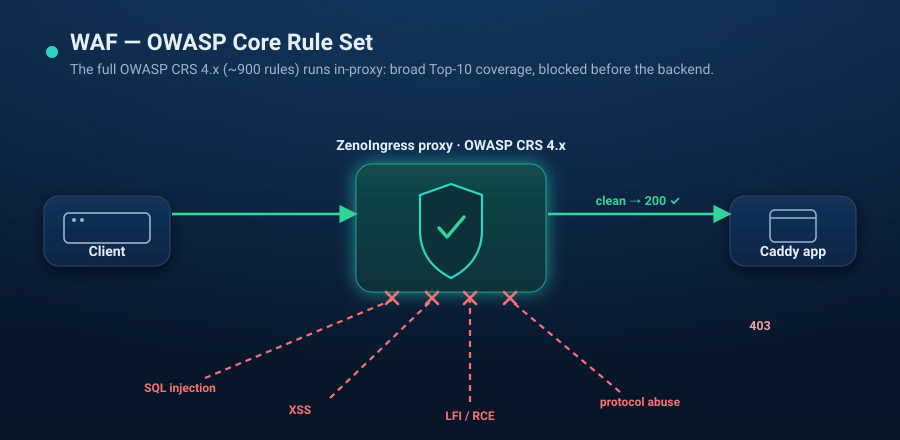

# Scenario 05 — WAF with the full OWASP Core Rule Set



The **advanced** WAF demo: the full **OWASP Core Rule Set (CRS 4.x)** running
in-proxy via coraza-proxy-wasm. Its sibling [scenario 04](../04-waf/) is the
**simple** version — a handful of hand-written coraza rules. Same plumbing; this
one loads the whole industry-standard rule set.

```
curl / browser -> ZenoIngress proxy [Coraza + OWASP CRS] -> Caddy (form page)
                        │
                   403 on SQLi / XSS / LFI / command injection / …
                   200 on clean input
```

`up.sh` is self-contained: it creates a local `kind` cluster and installs
zenoingress from the public chart.

## Prerequisites

- `docker`, [`kind`](https://kind.sigs.k8s.io/), `kubectl`, and [`helm`](https://helm.sh/) 3.8+ (OCI support)
- **Internet from the cluster** — the proxy's init container downloads the WAF module

## Run

```bash
./up.sh        # kind + ZenoIngress + Coraza module + app + WafPolicy (full CRS)
./verify.sh    # curls clean vs attack payloads, asserts 200 vs 403
./down.sh      # delete the kind cluster
```

Then browse it: `kubectl -n waf-crs port-forward svc/waf-gateway-zenoingress 18080:80`
and open <http://localhost:18080>. input or click a sample and watch allowed vs. blocked.

## Simple vs. advanced

| | [scenario 04](../04-waf/) (simple) | this (advanced) |
|---|---|---|
| Rules | a few hand-written `SecRule`s (`@detectSQLi`/`@detectXSS`) | full OWASP CRS 4.x (~900 rules) |
| Coverage | SQLi, XSS, path traversal | OWASP Top-10 breadth (SQLi, XSS, LFI/RFI, RCE, protocol, …) |
| Startup | fast | slower (fetch + compile CRS) |
| When | you want a couple of targeted checks | you want the standard baseline |

## How it works

- **`values-waf.yaml`** uses the chart's `proxy.initContainers` / `extraVolumes`
  hooks to fetch [`coraza-proxy-wasm`](https://github.com/corazawaf/coraza-proxy-wasm)
  (0.6.0) into an emptyDir mounted read-only at `/waf`, and bumps proxy memory to
  1Gi (CRS compiles ~900 rules per pooled instance).
- **`WafPolicy` `owasp-crs`** loads the CRS via the module's embedded aliases:
  `Include @recommended-conf`, `Include @crs-setup-conf`,
  **`Include @owasp_crs/*.conf`** (the glob — `@owasp_crs` alone is a directory
  and fails to load), then `SecRuleEngine On` to block rather than only log.
- The **`HTTPRoute`** attaches the policy via an `ExtensionRef` filter.

## Tuning knobs

- **Detection-only** (log, don't block) during rollout: set `detectionOnly: true`
  on the `WafPolicy`.
- **Paranoia level / exclusions:** add `SecAction`/`SecRuleRemoveById` directives
  to `spec.rules` after the includes.
- **POST bodies:** set `inspectRequestBody: true` (adds latency).

> No license needed — every feature is free in single-cluster Community.
