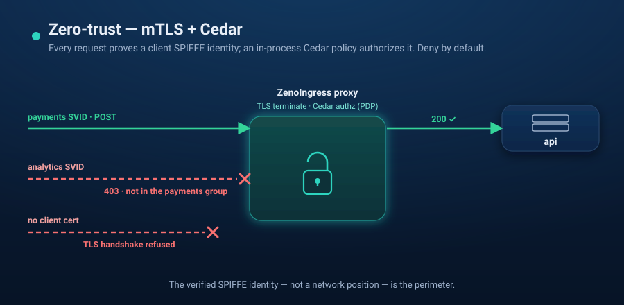

# Scenario 06 — Zero-trust (mTLS + Cedar)



A network position buys an attacker nothing. Every request must present a valid
client **SPIFFE SVID** (mTLS), and an in-process **Cedar** policy authorizes on
that cryptographic identity — deny-by-default, no sidecar, no external PDP.

```
mTLS client SVID ─▶ ZenoIngress proxy ─▶ [Cedar AuthzPolicy] ─▶ api
      │                    │                      │
 GEP-91 frontend      TLS terminate    x-spiffe-id (from the cert) = principal
 (no cert → 🚫)                        permit: payments SVID + POST /api/payments
```

`up.sh` is self-contained: it creates a local `kind` cluster, mints a throwaway
demo PKI, and installs zenoingress from the public chart.

## Prerequisites

- `docker`, [`kind`](https://kind.sigs.k8s.io/), `kubectl`, [`helm`](https://helm.sh/) 3.8+, and `openssl`
- Internet access from the cluster (public images + Gateway API CRDs)

## Run

```bash
./up.sh        # kind + Gateway API CRDs + PKI + ZenoIngress + mTLS Gateway + Cedar
./verify.sh    # payments→200, analytics→403, wrong-method→403, no-cert→handshake refused
./down.sh      # delete the kind cluster
```

## What it shows

| Request | Result | Why |
|---|---|---|
| `payments` SVID, `POST /api/payments` | **200** | in `Group::"payments"`, method+path permitted |
| `analytics` SVID, `POST /api/payments` | **403** | valid cert, but not in the payments group |
| `payments` SVID, `GET /api/payments` | **403** | method not permitted (deny-by-default) |
| no client cert | **handshake refused** | the Gateway requires a client certificate (GEP-91) |

## How it works

- **`gen-certs.sh`** mints a CA, a server cert, and two client SVIDs with
  `spiffe://demo.zeno/{payments,analytics}` URI SANs. `up.sh` loads the server
  certificate as a Secret and the client CA as a ConfigMap (`ca.crt`). The generated `certs/` are throwaway and are
  git-ignored — never commit them.
- The **Gateway** terminates TLS and requires client certificates for all its
  HTTPS listeners with GEP-91 `spec.tls.frontend.default.validation`
  (`caCertificateRefs` → the CA ConfigMap; `mode` defaults to
  `AllowValidOnly`). A certificate that does not chain to that CA, or none at
  all, fails the TLS handshake. Use `spec.tls.frontend.perPort` to set it per
  port.
- The proxy extracts the verified client cert's SPIFFE URI SAN and sets it as
  `x-spiffe-id` (stripping any inbound value). The **`AuthzPolicy`** reads that
  header as the Cedar principal and evaluates group membership + method + path.

## Notes / caveats

- Client-certificate validation is Standard since Gateway API v1.5. Releases
  before ZenoIngress 0.1.5 used the experimental per-listener
  `tls.frontendValidation` field, which the v1.5+ CRDs no longer keep; move it
  to `spec.tls.frontend` as shown here.
- SVIDs are minted with `openssl` (no SPIRE) so the scenario stays self-contained.
- Client-certificate settings are checked on the listener status: an unusable CA
  reference shows up as `ResolvedRefs=False` (`InvalidCACertificateRef`,
  `RefNotPermitted`, ...), and with no usable CA the listener refuses every
  handshake rather than serving without client authentication.
