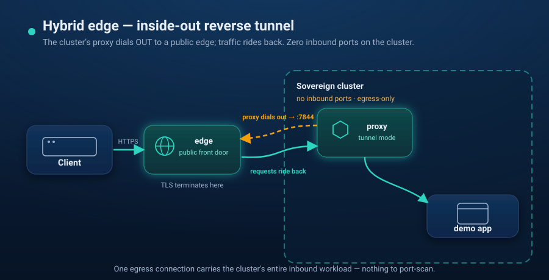

# Scenario 07 — Hybrid edge (reverse tunnel)



Expose a **sovereign cluster that has no inbound ports** to the public internet,
using the ZenoIngress **edge** and an inside-out reverse tunnel. The in-cluster
proxy **dials out** to a public edge; client traffic rides back over the
connection the cluster itself opened. Nothing listens for inbound connections on
the cluster.

```
 client ──▶ zenoingress-edge (public front door) ──▶ reverse tunnel ──┐
                                                                       │
        sovereign kind cluster:  proxy ── dials OUT to :7844 ──────────┘
          controller + proxy (tunnel mode) + demo app
          proxy Service = ClusterIP  →  NO inbound ports on the cluster
```

The edge here runs the public `zenoingress-edge` **image as a container** on the
`kind` docker network. That container stands in for how the edge is really
deployed — a public VM or container-platform node (e.g. built from the project's
hardened Hetzner image, or on a global Anycast container platform). Running it as
a container, rather than inside Kubernetes, keeps the demo faithful to the
architecture: **the edge is not a cluster workload.**

> **Self-contained.** The only ZenoIngress pieces are the published `zenoingress-edge`
> image and the chart; the backend is a stock `caddy` image. No other zeno-\* repos.

## Prerequisites

- `docker`, [`kind`](https://kind.sigs.k8s.io/), `kubectl`, [`helm`](https://helm.sh/) 3.8+ (OCI support), and `openssl`
- Internet access from the cluster (public images + Gateway API CRDs)

## Run

```bash
./up.sh        # kind cluster + edge container + ZenoIngress (tunnel mode) + demo app
./verify.sh    # curls the edge; proves traffic tunnels into the cluster
./down.sh      # remove the edge container + delete the cluster
```

`verify.sh` curls `https://localhost:8443/` (the edge's data plane) with the demo
Host header and confirms the in-cluster app answered — even though the cluster
exposes no inbound port.

## How it works

- **`gen-certs.sh`** mints a throwaway self-signed cert for the edge (git-ignored;
  never commit it).
- **The edge container** runs `zenoingress-edge` with token authentication:
  `gen-certs.sh` writes a random tunnel token and an edge config
  (`certs/edge-auth.yaml`) that accepts that token for `*.demo.zenoingress.test`
  only, and `up.sh` gives the same token to the chart
  (`proxy.tunnel.auth.token`). The edge refuses tunnels without a valid token,
  and a token cannot register hostnames outside its pattern. It uses the
  self-signed cert, serving a TLS **data plane** on `:8443` (published to your
  host) and a **control plane** on `:7844` (reached by the proxy over the `kind`
  docker network). `up.sh` discovers the container's IP and passes it to the chart.
- **The chart in tunnel mode** (`values-tunnel.yaml`) renders a proxy that opens
  **no inbound listener** — it dials the edge and registers
  `app.demo.zenoingress.test`. The proxy Service is `ClusterIP`; there is no
  LoadBalancer and no public IP.
- **TLS terminates at the edge.** The cluster-side `Gateway` listener is plain
  HTTP: the edge decrypts and relays each request over the tunnel, and the proxy
  serves it as an ordinary HTTP connection to the backend.

## From demo to production

- **Real edge:** run `zenoingress-edge` on a public node — a hardened VM or a
  container platform — instead of a local container. The cluster side is
  identical; only the edge address changes.
- **Harden the trust:** this demo authenticates the proxy with a token but does
  not verify the edge's self-signed certificate (`verify: false`). For real
  deployments, give the edge a certificate the proxy can verify
  (`tls.verify: true`, with `tls.caSecret` pinning your CA), keep the token in a
  Secret (`proxy.tunnel.auth.existingSecret`), or switch to `--auth-mode mtls`
  with client certificates (`tls.clientCertSecret`). The edge refuses
  `--auth-mode none` unless started with `--insecure-allow-no-auth`.
- **HA / multi-region:** run several edges (different regions) and steer clients
  with DNS/Anycast. A multi-edge variant of this scenario could be added later.

## Notes / caveats

- If the tunnel's control-plane TLS handshake won't complete against the
  self-signed cert, run the edge with `--no-control-tls` and set
  `tls.enabled: false` in `values-tunnel.yaml` (plaintext control plane).
- The tunnel proxy only reports Ready once the controller has routes to publish,
  which is why `up.sh` applies the Gateway/HTTPRoute **after** the chart install.
