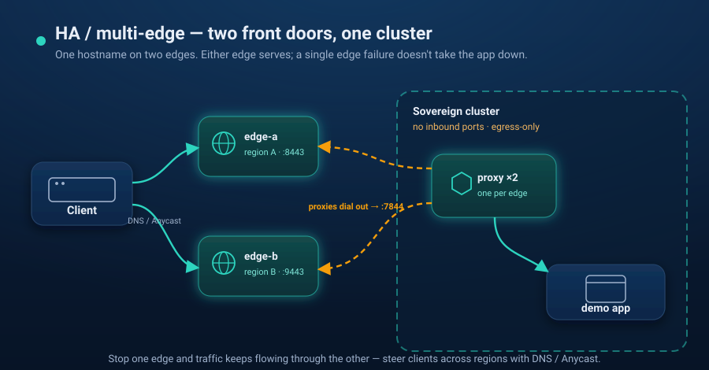

# Scenario 08 — HA / multi-edge



Put **two edges** (two "regions") in front of **one sovereign cluster**. The proxy
dials out to both; the same hostname is served through either edge, and a single
edge failure does not take the app down. This is the high-availability / DR shape
of [scenario 07](../07-hybrid-edge-tunnel/).

```
 client ──▶ edge-a (:8443) ─┐
            edge-b (:9443) ─┴─ reverse tunnels ─▶ proxy (one per edge) ─▶ demo app
   sovereign kind cluster · no inbound ports
```

Both edges run the public `zenoingress-edge` image as containers on the `kind`
docker network (each standing in for a public VM / container-platform node in a
different region). The chart's tunnel mode renders **one proxy Deployment per
edge**; each dials its edge and registers the hostname there. Because
hostname-conflict is enforced *per edge*, the same hostname on two edges is
allowed — that's the DR pattern.

> **Self-contained.** The only ZenoIngress pieces are the `zenoingress-edge`
> image and the chart; the backend is a stock `caddy` image.

## Prerequisites

- `docker`, [`kind`](https://kind.sigs.k8s.io/), `kubectl`, [`helm`](https://helm.sh/) 3.8+ (OCI support), and `openssl`
- Internet access from the cluster (public images + Gateway API CRDs)
- Host ports `8443` and `9443` free

## Run

```bash
./up.sh        # kind cluster + TWO edge containers + ZenoIngress (tunnel mode, 2 edges) + demo app
./verify.sh    # both edges serve 200; stop edge-a and edge-b keeps serving
./down.sh      # remove both edge containers + delete the cluster
```

`verify.sh` proves the app answers through **both** `localhost:8443` (edge-a) and
`localhost:9443` (edge-b), then stops edge-a and shows edge-b still serving `200`
(edge-a restarts afterwards).

## How it works

- **Two edge containers** (`edge-a`, `edge-b`) run `zenoingress-edge` with the same
  self-signed cert, each exposing a TLS data plane (`:8443` / `:9443` on your host)
  and a control plane (`:7844` on the `kind` network).
- **`values-tunnel.yaml`** lists two edges; `up.sh` injects their container IPs via
  `--set proxy.tunnel.edges[0..1].address`. The chart renders `proxy-tunnel-0`
  (dials edge-a) and `proxy-tunnel-1` (dials edge-b).
- **The proxy Service is `ClusterIP`** — the sovereign cluster still has no inbound
  ports; both edges reach it only over the tunnels the proxies dialed out.

## From demo to production

- **Real edges:** run each `zenoingress-edge` on a public node in a different
  region; steer clients to the nearest healthy edge with **DNS / Anycast** and fail
  over by withdrawing a region.
- **Harden the trust:** this demo uses `--auth-mode=none` + a self-signed cert with
  `verify: false`. For production, switch each edge to `--auth-mode mtls` with your
  own CA and pin it on the proxy (`tls.verify: true`).

## Notes / caveats

- After `verify.sh` restarts edge-a, give it a few seconds to re-establish its
  tunnel before expecting `:8443` to serve again.
- The original client IP is not propagated across the tunnel today; in tunnel mode
  the proxy sees the edge as the source. Put client-IP-based policy at the edge.
